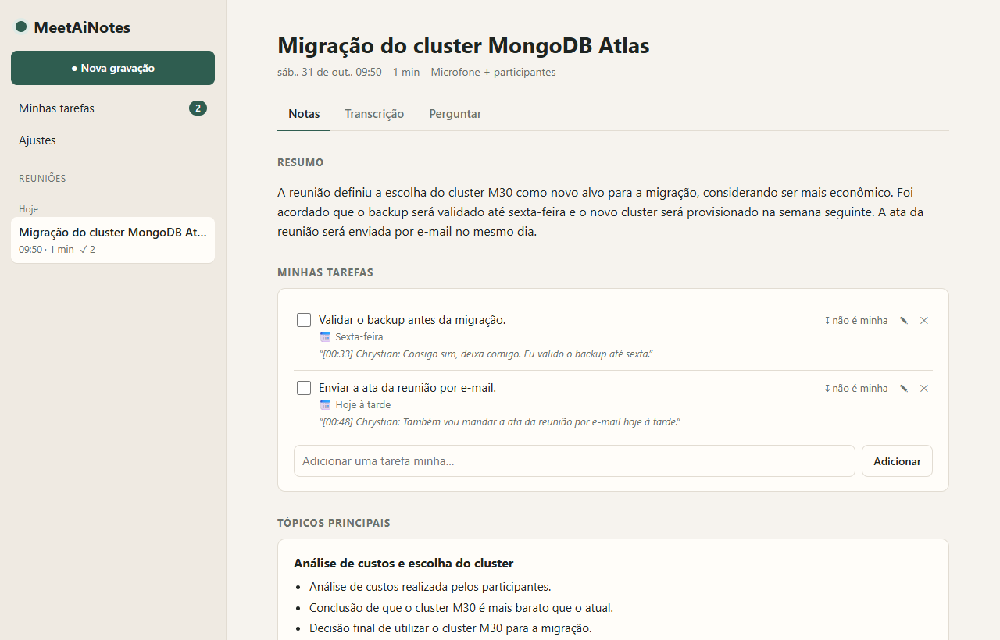
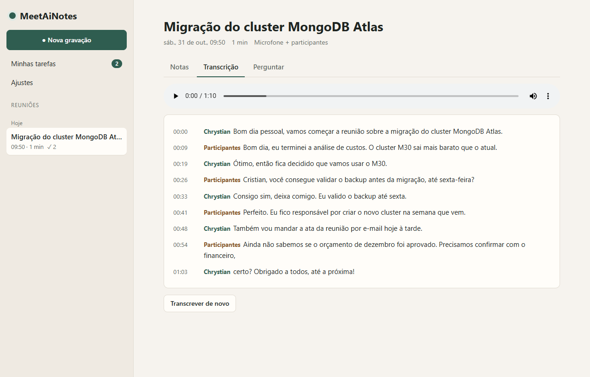
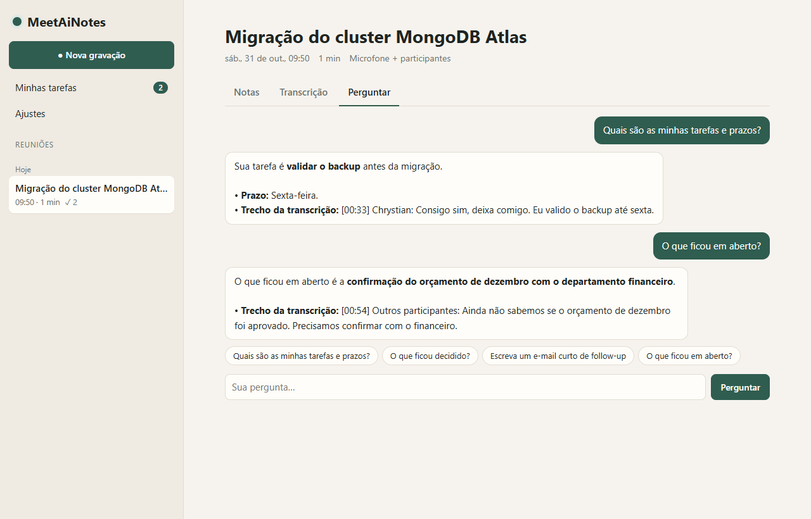
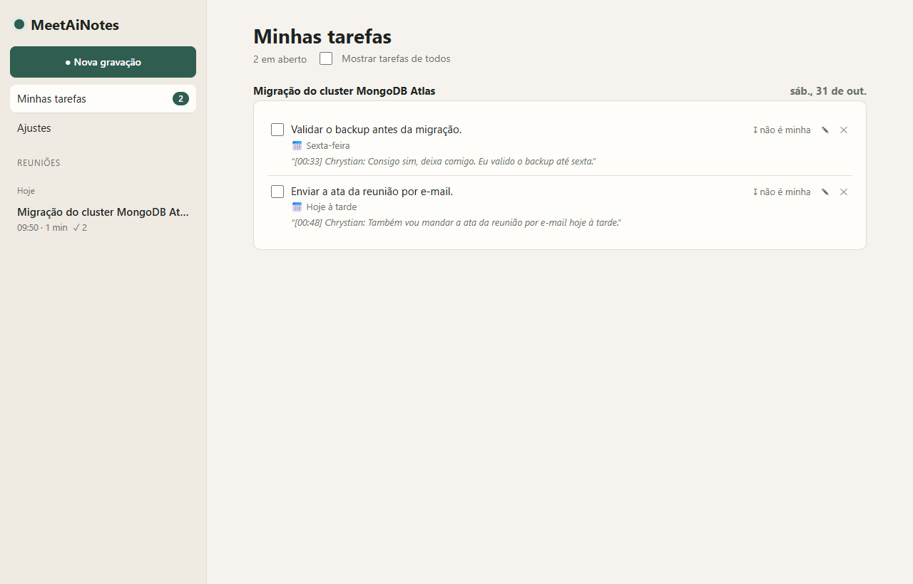
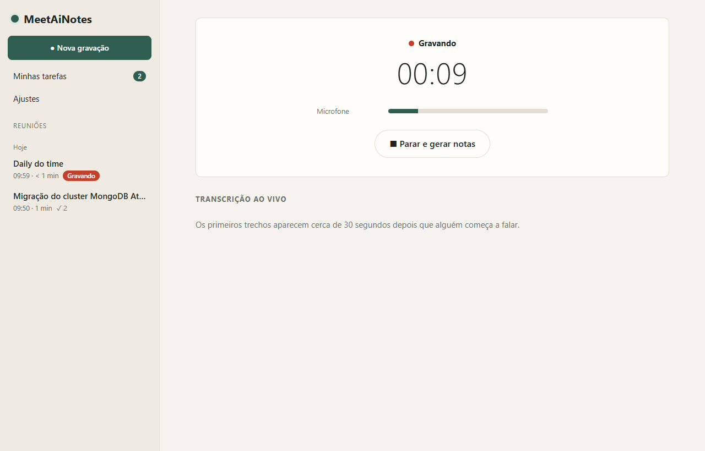
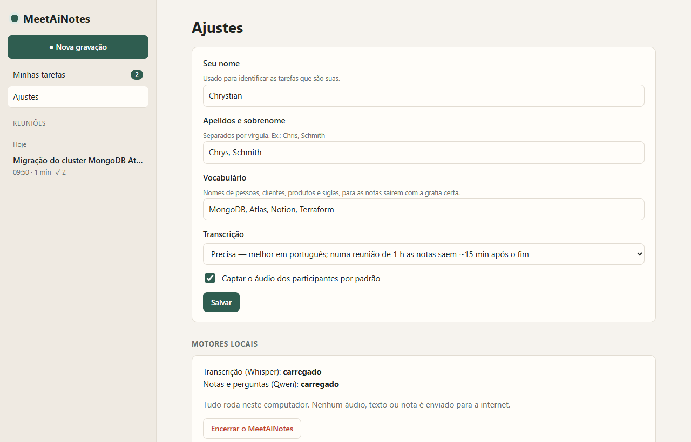
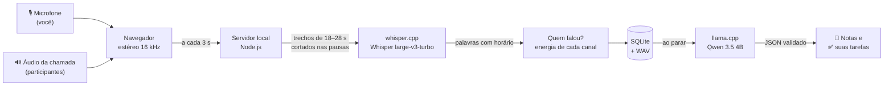

<div align="center">

# 🎙️ MeetAiNotes

**Seu caderno de reuniões com IA, 100% local.**

Grava a reunião, transcreve em português e entrega as notas prontas: resumo, tópicos principais,
decisões e **as tarefas que são suas**. Nada sai do seu computador.


[Funcionalidades](#-funcionalidades) •
[Instalação](#-instalação-passo-a-passo) •
[Como usar](#-como-usar) •
[Como funciona](#-como-funciona) •
[Privacidade](#-privacidade) •
[Autor](#-autor)



</div>

---

## 💡 Por que o MeetAiNotes?

Ferramentas de ata automática costumam mandar o áudio das suas reuniões para a nuvem. O MeetAiNotes
faz tudo **no seu próprio notebook**: a transcrição roda com o [Whisper](https://github.com/openai/whisper)
e as notas com o [Qwen 3.5](https://huggingface.co/unsloth/Qwen3.5-4B-GGUF), ambos executados
localmente. Sem conta, sem assinatura, sem enviar dados para lugar nenhum.

E ele foi pensado para o que importa depois da reunião: **o que ficou para você fazer**.

## ✨ Funcionalidades

| | |
|---|---|
| 🎙️ **Grava qualquer chamada** | Teams, Meet, Zoom, Slack, WhatsApp Web… Capta o seu microfone e o áudio dos participantes. |
| 🗣️ **Sabe quem falou** | Separa na transcrição o que **você** disse do que os **participantes** disseram. |
| ⚡ **Transcrição ao vivo** | O texto aparece enquanto a reunião acontece, em português. |
| 📝 **Notas automáticas** | Ao parar a gravação: título, resumo, tópicos principais, decisões e pendências. |
| ✅ **Suas tarefas** | Reconhece tarefas atribuídas pelo seu nome, pedidas a você ou assumidas por você ("deixa comigo", "eu vejo isso"), com prazo e o trecho exato da conversa. |
| 📋 **Minhas tarefas** | Uma lista única com as suas tarefas de todas as reuniões, para marcar como feitas. |
| 💬 **Pergunte à reunião** | "O que ficou decidido?", "Escreva o e-mail de follow-up"… As respostas citam o horário da conversa. |
| 🎧 **Ouça o trecho** | Clique no horário de qualquer fala para ouvir aquele momento da gravação. |
| ✍️ **Tudo editável** | Renomeie a reunião, edite ou crie tarefas, faça anotações pessoais e regere as notas com instruções ("foque nos custos"). |
| 🛟 **À prova de queda** | Se o computador desligar no meio da reunião, a gravação é recuperada e processada ao reabrir. |
| 🔒 **Privado** | Nenhum áudio, texto ou nota sai do seu computador. |

<table>
  <tr>
    <td width="50%"><p align="center"><b>Transcrição com quem falou</b></p></td>
    <td width="50%"><p align="center"><b>Perguntas sobre a reunião</b></p></td>
  </tr>
  <tr>
    <td width="50%"><p align="center"><b>Minhas tarefas, de todas as reuniões</b></p></td>
    <td width="50%"><p align="center"><b>Gravação com transcrição ao vivo</b></p></td>
  </tr>
</table>

## 💻 Requisitos

| | Mínimo | Recomendado |
|---|---|---|
| Sistema | Windows 10 ou 11, 64 bits | Windows 11 |
| Memória | 8 GB de RAM (mais lento) | 16 GB de RAM ou mais |
| Disco | 4 GB livres | 10 GB livres (as gravações ocupam ~230 MB por hora) |
| Navegador | Microsoft Edge (já vem no Windows) | — |
| Placa de vídeo | Não precisa | Qualquer uma com Vulkan acelera as notas |

Não é preciso instalar Node.js, Python nem nada antes: o instalador cuida de tudo.

## 📦 Instalação passo a passo

### 1. Baixe o projeto

Clique no botão verde **`<> Code`** no topo desta página e depois em **Download ZIP**.

> Prefere Git? `git clone https://github.com/chrystianschmith/MeetAiNotes.git`

### 2. Extraia numa pasta definitiva

Clique com o botão direito no ZIP baixado → **Extrair tudo…** e escolha uma pasta que você não vá
apagar, por exemplo `C:\Users\<seu usuário>\MeetAiNotes`.

> ⚠️ Não rode de dentro do ZIP nem da pasta Downloads: é nessa pasta que ficam os modelos e as suas reuniões.

### 3. Rode o instalador

Abra a pasta extraída e dê dois cliques em **`instalar.cmd`**.

- Se o Windows mostrar **"O Windows protegeu o computador"**, clique em **Mais informações → Executar assim mesmo**.
  Isso acontece com qualquer script baixado da internet; o código do instalador é aberto e você pode lê-lo em [`instalar.ps1`](instalar.ps1).
- O instalador baixa os motores e modelos das fontes oficiais (**cerca de 3,3 GB** na primeira vez)
  e confere a integridade de cada arquivo pelo **SHA-256**.
- Se o seu computador não tiver um Node.js compatível, ele instala uma cópia portátil, usada só pelo MeetAiNotes.
- No fim, cria o atalho **MeetAiNotes** na área de trabalho.

Se a internet cair no meio, é só rodar o `instalar.cmd` de novo: ele continua de onde parou.

```text
=== Instalação do MeetAiNotes ===
Node.js:
  ok (portátil já instalado)
Motores e modelos (cerca de 3,3 GB na primeira vez):
  baixando: Motor de transcrição (whisper.cpp b5454)
  baixando: Modelo de notas e perguntas (Qwen 3.5 4B, 2,7 GB)
  ...
Pronto! Abra o MeetAiNotes pelo atalho na área de trabalho.
```

### 4. Abra e diga seu nome

Abra pelo atalho **MeetAiNotes**. Na primeira vez, informe o seu nome e, se quiser, apelidos e
sobrenome. É assim que o MeetAiNotes reconhece, na conversa, as tarefas que são suas.

## 🚀 Como usar

### Gravar uma reunião

1. Entre na chamada normalmente (Teams, Meet, Zoom…).
2. No MeetAiNotes, clique em **● Nova gravação**. Dê um título, se quiser (senão, a IA sugere um).
3. Deixe marcado **Captar os outros participantes** e clique em **Começar a gravar**.
4. O navegador vai pedir para compartilhar a tela:
   - escolha a aba **Tela inteira**;
   - marque **Compartilhar áudio do sistema**;
   - clique em **Compartilhar**.

   Só o **áudio** é usado; a imagem da tela é descartada.
5. Acompanhe a transcrição ao vivo. Os medidores mostram o nível do seu microfone e dos participantes.
6. Ao terminar, clique em **■ Parar e gerar notas**. A transcrição é finalizada e as notas aparecem
   sozinhas alguns minutos depois. Pode continuar usando o computador normalmente.

> 💡 Reunião presencial? Desmarque *Captar os outros participantes* e grave só pelo microfone.

### Depois da reunião

- **Notas**: resumo, suas tarefas, tópicos, decisões, pendências e tarefas dos outros. Tudo editável.
- **Transcrição**: a conversa completa, com quem falou e o horário. Clique no horário para ouvir.
- **Perguntar**: converse com a reunião. Há sugestões prontas, como o e-mail de follow-up.
- **Minhas tarefas** (menu lateral): todas as suas tarefas em aberto, de todas as reuniões.

### Ajustes



| Ajuste | Para que serve |
|---|---|
| **Seu nome** e **apelidos** | Identificar as tarefas que são suas, mesmo quando a transcrição erra a grafia do nome. |
| **Vocabulário** | Nomes de clientes, produtos e siglas, para as notas saírem com a grafia certa. |
| **Transcrição** | **Precisa** (padrão, melhor qualidade) ou **Rápida** (cerca de 3x mais rápida, para computadores mais fracos). |
| **Captar participantes** | Se a opção vem marcada por padrão em cada nova gravação. |
| **Encerrar** | Fecha o MeetAiNotes e libera a memória dos modelos. |

> **⚖️ Importante:** avise os participantes de que a reunião está sendo gravada. Gravar conversas sem
> o conhecimento das pessoas pode violar a LGPD e as políticas da sua empresa.

## ⚙️ Como funciona



1. **Captura.** O navegador grava o microfone no canal esquerdo e o áudio da chamada no direito, em
   16 kHz, e envia ao servidor local a cada 3 segundos. O áudio vai sendo salvo em WAV no disco, então
   nada se perde se o computador desligar.
2. **Transcrição ao vivo.** O áudio é cortado em trechos de 18 a 28 segundos, sempre num momento de
   silêncio para não partir palavras ao meio, e transcrito pelo
   [whisper.cpp](https://github.com/ggml-org/whisper.cpp) com detecção de voz (Silero VAD) e
   horário de cada palavra. Frases-fantasma típicas do Whisper ("Legendas pela comunidade…") são filtradas.
3. **Quem falou.** Cada palavra é atribuída ao canal que tinha mais energia naquele instante:
   microfone = você, áudio do sistema = participantes. Assim a reunião é transcrita uma única vez,
   sem dobrar o processamento.
4. **Notas.** Ao parar, a transcrição vai para o [llama.cpp](https://github.com/ggml-org/llama.cpp)
   rodando o Qwen 3.5 4B, com um prompt que sabe o seu nome e apelidos. A resposta é forçada a seguir
   um **esquema JSON** (título, resumo, tópicos, decisões, tarefas, pendências), então nunca vem
   quebrada. Reuniões longas são resumidas por partes e depois consolidadas.
5. **Suas tarefas.** Uma tarefa é sua quando o responsável é você (pelo nome ou apelido) ou quando o
   modelo identifica que ela foi pedida a você ou assumida por você, sempre com o trecho da conversa
   como prova.

Os motores são processos locais iniciados sob demanda, e a transcrição roda com **prioridade baixa**
para não atrapalhar a própria chamada de vídeo.

### Tecnologias

| Parte | Tecnologia |
|---|---|
| Interface | HTML, CSS e JavaScript puros, aberta como app pelo Edge (tema claro e escuro) |
| Captura de áudio | Web Audio API + AudioWorklet |
| Servidor | Node.js 22, **sem nenhuma dependência do npm** |
| Banco de dados | SQLite embutido no Node.js (`node:sqlite`) |
| Transcrição | whisper.cpp + Whisper large-v3-turbo (ou small, no modo Rápido) + Silero VAD |
| Notas e perguntas | llama.cpp (Vulkan) + Qwen 3.5 4B |

## 📊 Desempenho

Medido num notebook comum: Intel Core i5-1235U, 32 GB de RAM, **sem placa de vídeo dedicada**.

| Etapa | Tempo |
|---|---|
| Transcrição "Precisa" (padrão) | ~1x a duração do áudio: acompanha a reunião ao vivo |
| Transcrição "Rápida" | ~3x mais rápida, com alguns erros de palavras |
| Notas, depois da transcrição | ~2 minutos (inclui carregar o modelo) |
| Perguntas | 5 a 40 segundos |

Numa reunião de 1 hora, conte com as notas prontas uns 15 a 20 minutos após o fim. Computadores mais
potentes são proporcionalmente mais rápidos.

## 🔒 Privacidade

- **Nada vai para a internet.** A internet só é usada pelo `instalar.cmd`, para baixar os motores e
  modelos das fontes oficiais (GitHub do ggml-org, Hugging Face e nodejs.org).
- **Sem telemetria**, sem conta, sem atualização automática.
- O servidor só aceita conexões do próprio computador (`127.0.0.1`) e recusa pedidos vindos de
  outros sites abertos no navegador.
- Gravações, transcrições e notas ficam em `data/`, dentro da pasta do MeetAiNotes. Para apagar uma
  reunião, use **Apagar reunião**; para apagar tudo, apague a pasta `data/`.

## 🛠️ Problemas comuns

<details>
<summary><b>Nada acontece ao abrir o atalho</b></summary>

Rode o `instalar.cmd` de novo e veja se aparece alguma mensagem de erro em vermelho. Se aparecer,
abra uma [issue](https://github.com/chrystianschmith/MeetAiNotes/issues) com o texto.
</details>

<details>
<summary><b>Não aparece a opção "Compartilhar áudio do sistema"</b></summary>

Ela só existe na aba **Tela inteira**. Janelas e abas individuais não compartilham o áudio do sistema.
</details>

<details>
<summary><b>A transcrição só tem as minhas falas</b></summary>

O áudio dos participantes não foi captado. Na próxima gravação, confira se *Captar os outros
participantes* está marcado e se você marcou **Compartilhar áudio do sistema**.
</details>

<details>
<summary><b>As notas estão demorando muito</b></summary>

Em **Ajustes**, troque a transcrição para **Rápida**. Fechar programas pesados durante o processamento
também ajuda. Com menos de 16 GB de RAM, o processamento é mais lento.
</details>

<details>
<summary><b>Deu erro na transcrição ou nas notas</b></summary>

Clique em **Tentar de novo** na própria reunião. Se persistir, os registros ficam em
`data/meetainotes.log`, `data/whisper.log` e `data/llm.log`.
</details>

<details>
<summary><b>Meu nome sai errado na transcrição</b></summary>

É normal o Whisper errar a grafia de nomes. Coloque as variações em **Apelidos e sobrenome** (por
exemplo "Cris, Christian"): o MeetAiNotes usa essa lista para reconhecer as suas tarefas mesmo assim.
</details>

## 🔄 Atualizar

Baixe a versão nova, extraia por cima da pasta atual e rode o `instalar.cmd`. As suas reuniões
(`data/`), os seus ajustes (`config.json`) e os modelos já baixados (`engines/`) são mantidos.

Com Git: `git pull` e depois `instalar.cmd`.

## 🗑️ Desinstalar

Apague a pasta do MeetAiNotes e o atalho da área de trabalho. Nada é instalado fora dessa pasta:
sem registro do Windows, sem serviços em segundo plano.

## 🧑‍💻 Para desenvolvedores

```text
MeetAiNotes/
├── server.js              API HTTP, gravação, fila de transcrição e notas
├── lib/
│   ├── audio.js           WAV, cortes nas pausas, separação de canais
│   ├── transcriber.js     Whisper por trechos, quem falou, filtro de alucinações
│   ├── summarizer.js      prompts, esquema JSON das notas e perguntas
│   ├── engines.js         inicia e conversa com whisper-server e llama-server
│   └── db.js              SQLite
├── public/                interface (HTML, CSS, JS e o AudioWorklet de captura)
├── test/                  testes de ponta a ponta com motores simulados
├── instalar.cmd / .ps1    instalador
└── MeetAiNotes.vbs        abre o servidor sem janela e o app no Edge
```

Rodar os testes (não precisa dos modelos baixados):

```bash
node test/run-tests.js
```

Rodar o servidor no terminal, vendo os registros:

```bash
node server.js
# depois abra http://127.0.0.1:4280
```

Contribuições são bem-vindas: abra uma [issue](https://github.com/chrystianschmith/MeetAiNotes/issues)
ou um pull request.

## 👤 Autor

<table>
  <tr>
    <td align="center">
      <a href="https://github.com/chrystianschmith">
        <br>
        <b>Chrystian Schmith</b>
      </a><br>
      <sub>Criador e mantenedor</sub>
    </td>
  </tr>
</table>

Se o MeetAiNotes te ajudou, deixe uma ⭐ no repositório!

## 📄 Licença e créditos

O código do MeetAiNotes é distribuído sob a licença [MIT](LICENSE).

Ele se apoia em projetos abertos incríveis, que o instalador baixa das fontes oficiais (não são
distribuídos neste repositório):

- [whisper.cpp](https://github.com/ggml-org/whisper.cpp) e [llama.cpp](https://github.com/ggml-org/llama.cpp) (MIT)
- Modelos [Whisper](https://github.com/openai/whisper) da OpenAI (MIT), convertidos pelo projeto whisper.cpp
- [Qwen 3.5 4B](https://huggingface.co/unsloth/Qwen3.5-4B-GGUF) (consulte a licença no card do modelo)
- [Silero VAD](https://github.com/snakers4/silero-vad) (MIT)
- [Node.js](https://nodejs.org) (MIT)
